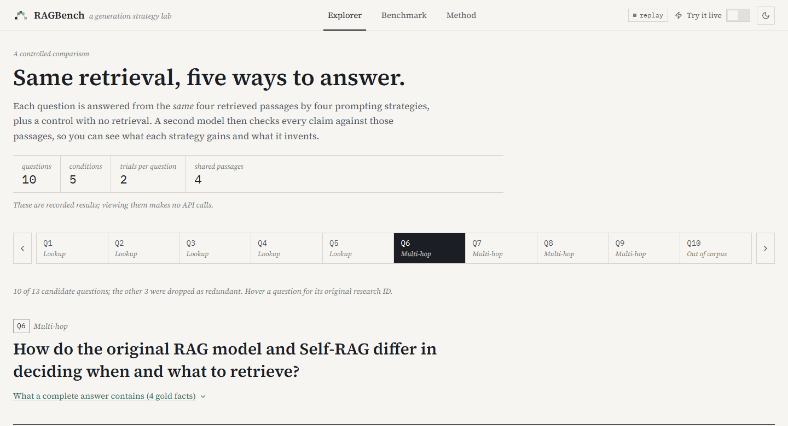
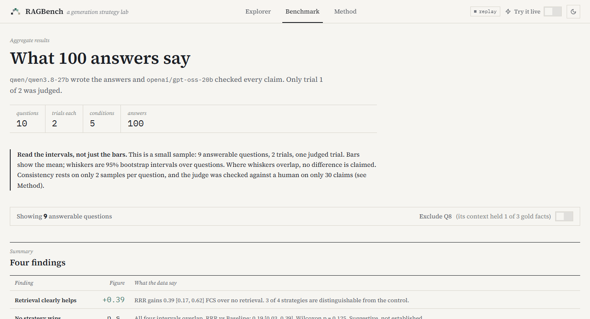

# RAGBench

**Does the way you prompt a RAG generator matter, or is retrieval doing all the work?** RAGBench answers that with a controlled experiment: the *same* retrieved passages go to four generation strategies (Baseline, Structured, RRR, Self-RAG) and a no-retrieval control, and a second, independent model then checks every claim in every answer against those passages. You can see exactly what each strategy gains, and what it invents.

<p align="center">
  
</p>

## What it found

**Retrieval matters far more than generation strategy.**

- **Retrieval clearly helps.** Faithful coverage (FCS, below) is 0.33 with no retrieval versus 0.53 to 0.72 with it. RRR gains +0.39 over the control (95% CI 0.17 to 0.62), Structured +0.32 and Self-RAG +0.30; Baseline's +0.20 is not distinguishable from zero.
- **No strategy beats the others.** The four strategies' intervals all overlap. The best candidate gap, RRR over Baseline (+0.19, CI 0.03 to 0.39), is suggestive only (Wilcoxon p = 0.125). Meanwhile Self-RAG uses about 4.8 times Baseline's tokens for no reliable gain.
- **Multi-hop retrieval is the real bottleneck.** On cross-document questions the retrieved passages often never contain the needed facts (one question: 1 of 3), so no prompt can fix the answer. Query decomposition, a larger k, document-balanced retrieval and cross-encoder reranking were all tried and none cleared a pre-set bar.

Results come from 10 questions, so read the confidence intervals, not just the bars. Full tables: [evaluation/results/summary.md](evaluation/results/summary.md).

<p align="center">
  
</p>

## How it works

```
 7 PDFs ──► clean + chunk ──► embed (MiniLM) ──► ChromaDB ──► top-4 passages ─┐
                                                                               │ identical for all
   Baseline │ Structured │ RRR │ Self-RAG (prompted) │ No-retrieval control ◄──┘
                                   │
                                   ▼
        judge model: split each answer into claims, check each against the passages
                                   │
                                   ▼
         groundedness · coverage of gold facts · FCS · consistency · latency · cost
```

- **Backend:** Python 3.11+, PyMuPDF, sentence-transformers (`all-MiniLM-L6-v2`), ChromaDB, FastAPI with server-sent events. Generator `qwen/qwen3.8-27b` and judge `openai/gpt-oss-20b` on Groq's free tier.
- **Frontend:** React 18, Vite, TypeScript, Tailwind, custom SVG charts. Replay is the default view; **Try it live** takes a visitor's own Groq key (held in memory only, sent per request in a header, never stored or logged) and runs any question, including your own, through all five conditions.
- **Evaluation:** claim-level groundedness, gold-fact coverage, FCS (their harmonic mean), semantic consistency, latency and list-price cost, with cluster-bootstrap 95% intervals over questions.

## Run it locally

You need Python 3.11+ and Node 18+. Developed and tested on Windows; the commands below are the same elsewhere apart from activating the virtualenv.

```bash
python -m venv .venv
source .venv/bin/activate            # Windows: .venv\Scripts\Activate.ps1
pip install -e ".[dev,retrieval,llm,eval,api]"
ragbench ingest                      # chunk the corpus and build the local index (downloads a ~90 MB model once)
ragbench serve                       # API on http://127.0.0.1:8000, docs at /docs
```

In a second terminal:

```bash
cd ui
npm install
npm run dev                          # UI on http://localhost:5173
```

- **No keys needed to explore.** The recorded benchmark is bundled in `ui/public/replay/`, so the Explorer, Benchmark and Method views work without the backend or any key.
- **Live mode** needs the API running and a Groq key pasted into the UI. A fully scored run is about 20,000 tokens. The server has no key of its own.
- **Port 8000 busy?** Run `ragbench serve --port 8001` and start the UI with `VITE_API_URL=http://127.0.0.1:8001`.
- **Try live mode offline:** `python scripts/mock_api.py 8001` serves the real API with a fake model. Its scores are canned, and the UI says so.
- **Re-run the benchmark** (needs `GENERATOR_API_KEY` and `JUDGE_API_KEY` in `.env`, copied from `.env.example`): `ragbench bench`, then `ragbench context-support`, `ragbench analyze` and `ragbench export-replay`. Runs are resumable.
- **Tests:** `pytest` (offline, fake models; the first run downloads the embedding model) and `cd ui && npm test`.
- **Where things live:** the virtualenv (`.venv/`), the Chroma index (`data/chroma/`), the LLM response cache (`.cache/llm_cache/`) and `ui/node_modules/` are all inside the project folder and gitignored. `RAGBENCH_CHROMA_DIR` and `RAGBENCH_CACHE_DIR` override the first two.

## Methodology

The short version: one retrieval, five generators, one independent judge. The judge splits each answer into atomic claims and labels each *supported*, *unsupported* or *contradicted* against the retrieved passages; coverage checks hand-written gold facts, each with a verbatim source quote. A refusal on an answerable question scores zero.

For depth: the app's **Method** page, [ARCHITECTURE_PLAN.md](ARCHITECTURE_PLAN.md) (design, trade-offs, the retrieval investigation) and [evaluation/results/summary.md](evaluation/results/summary.md) (every table, plus the question numbering: the app shows Q1 to Q10, the data uses the original research IDs).

## Limitations

- **Small sample.** 10 questions (9 answerable), 2 trials, and only the first trial is judged, because the free tier cannot fund more. Intervals are wide.
- **The judge is an LLM, validated lightly.** On 30 human-labelled claims it agreed 28 times (93%, kappa 0.88). The sample was not randomly drawn, there was one labeller, and coverage and FCS are validated far less than groundedness. All three disagreements found ran against retrieval's advantage, so the headline is probably conservative.
- **Self-RAG is prompt-emulated.** It is draft, critique and revise with prompts, not the fine-tuned model with learned reflection tokens.
- **Retrieval limits were investigated, not fixed.** Cross-document questions remain weak by design of the corpus and retriever; the attempted remedies are documented in the plan.
- **One small corpus, one model pair.** Seven PDFs, and results may not transfer to other models or domains.

## Credits

Built as a rebuild of a Master's (M2DS) coursework project comparing RAG generation strategies. The original compared strategies on surface statistics such as answer length; this version measures whether each claim is actually supported.

Released under the [MIT License](LICENSE). Never commit keys: `.env` is gitignored and a test scans for key-shaped strings.
